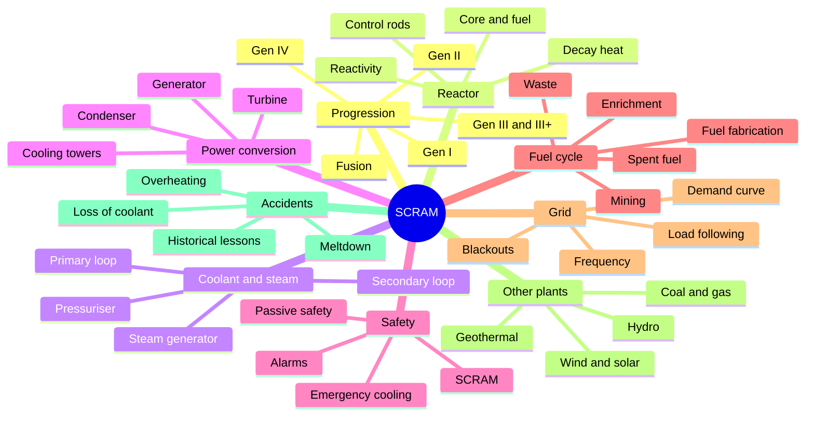

# SCRAM design (draft)

Vázlat a kickoffhoz. Minden javítható. / Draft for the kickoff; everything is open to change.

## Premise

The player is a plant operator and builder: grow from a simple heat source to a full
nuclear plant and keep it running safely as grid demand changes.

## Pillars (draft)

1. Operate, don't just build.
2. Failure is understandable.
3. Systems interlock.
4. Realism that teaches, simplified until it plays.

## Progression tiers (decided: tiers stay)

Tiers follow real reactor generations. Each tier brings a new mechanic, not just bigger numbers.

| Tier | Real-world counterpart | Idea |
|------|------------------------|------|
| Gen I | 1950s-60s prototypes | Manual control, few safety systems |
| Gen II | Commercial PWR/BWR/CANDU fleet | Active safety systems |
| Gen III / III+ | Improved designs with passive safety | Passive safety, modular builds |
| Gen IV | Experimental designs | New coolants, closed fuel cycle |
| Endgame | Fusion | Different physics |

## Mindmap

## Open questions for the kickoff

- [ ] One reactor type (PWR) evolving through tiers, or a different type per tier?
- [ ] What unlocks the next tier: research, a completed task, or grid demand?
- [ ] How many tiers in the first release? (suggestion: Gen I-II)
- [ ] Is Gen I really playable or only a tutorial?
- [ ] Which real behaviour is the centrepiece?
- [ ] How harsh is a meltdown for the player's world?
- [ ] Real units (MW, bar, K) or fictional?
- [ ] Which three systems form the vertical slice?
